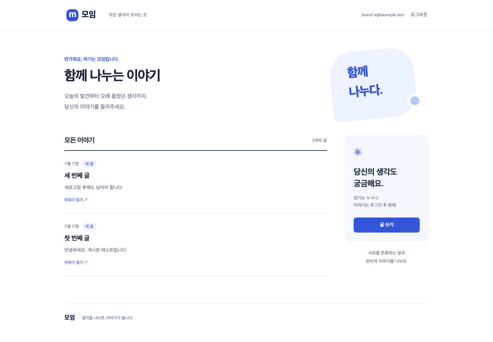
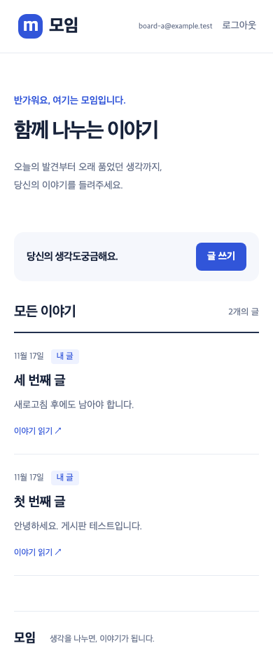

# [FEAT] 회원 게시판 구현 및 통합 5개 시나리오 검증

정본 템플릿: https://app.notion.com/p/41b04552316d81f29edbdab0f4b68f2b
이 문서는 해당 PR의 작성 결과물이며 재사용 템플릿 복사본이 아니다.

## 📌 관련 이슈

원격 이슈 미생성. 작업 요청: https://app.notion.com/p/41b04552316d8079a925f96a7f3a8024

## 📝 작업 내용

풀스택 개발·협업 워크플로우가 실제 회원 게시판 제작에 적용되는지 확인하기 위한 첫 구현이다.
회원·공개 읽기·작성자만 수정/삭제하는 동작을 UI부터 DB까지 연결했다.
사용자가 선택한 INT-01~05만 실제 브라우저·서버·저장소로 검증하고, 클라우드 배포 결과는 구분했다.

## 🔍 변경 사항

- [x] 기능 추가
- [x] 버그 수정
- [x] 테스트 추가 / 수정
- [x] 문서 수정

## 💡 구현 방법 / 주요 변경 포인트

서버 세션과 CSRF를 사용해 로그아웃 자격의 재사용과 외부 위조 요청을 차단한다.
작성자 ID는 요청 본문을 신뢰하지 않고 인증 주체에서 정한다. H2 파일 저장으로 재기동 후 데이터가 유지된다.
무료 단일 인스턴스 배포를 위해 별도 DB 서비스 대신 영속 볼륨을 사용하며, 고가용성·백업 복구는 보장하지 않는다.
Vercel 동일 출처 프록시는 제3자 쿠키 의존을 피한다. 실제 클라우드 왕복은 배포 후 확인해야 한다.

## ✅ 테스트 방법

1. Java 21·Gradle 9.2.1·Node 22.12 이상, npm ci 및 npx playwright install chromium.
2. gradle -p backend bootJar copyH2 → npm run build → npm test.
3. 통합 5/5 통과(20.6초), 실제 JVM 재기동·읽기 전용 DB 비교 포함. evidence/review/summary.md 참조.

## 📸 스크린샷

## ⚠️ 리뷰어에게 전달 사항

실제 Railway/Vercel 배포·장애 복구는 아직 실행하지 않았다. Vercel 재로그인이 필요하다.
운영 세션은 재기동 시 만료된다. /data 영속 볼륨과 인스턴스 1개가 배포 전제다.
5개 통과를 전체 24개 명세 통과나 워크플로우 성능 개선으로 해석하지 않는다.
기능별 작은 커밋으로 나눴지만 생성된 잠금 파일만 400줄을 넘는다.

## 📋 셀프 체크리스트

- [x] 비밀번호 원문/인증 쿠키를 저장소·로그에 남기지 않음
- [x] 통합 테스트 5개 작성·실행
- [x] 실제 빌드·화면·정적 독립 리뷰 수행
- [x] PR 제목에 변경 목적 명시
- [ ] 사용자 최종 PR 승인
- [ ] 원격 push / PR / 병합 / 배포 및 운영 검증
